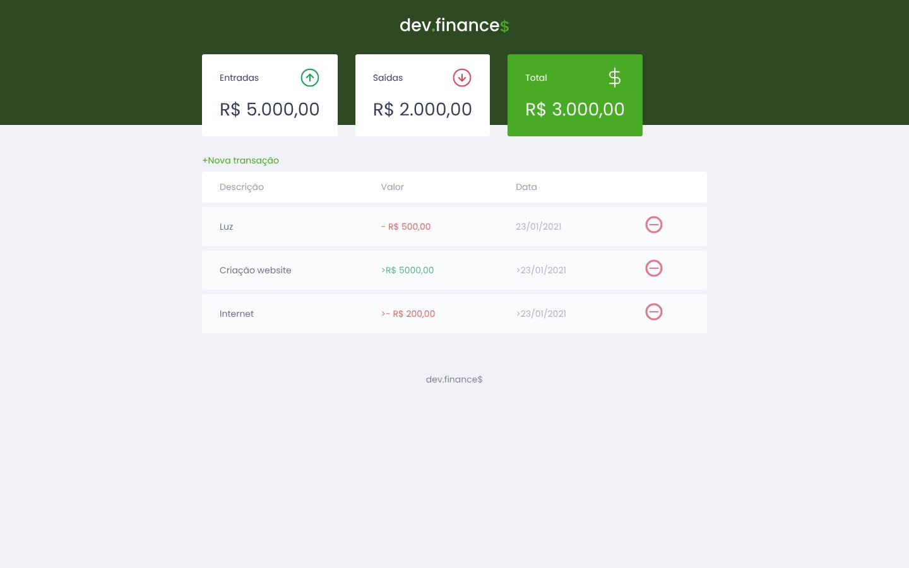
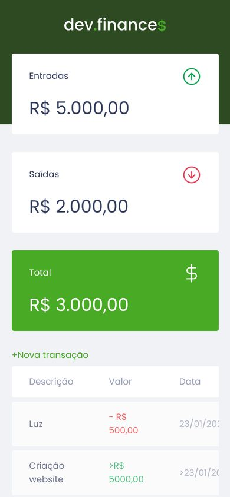

# dev.finance$

Interface de um controle financeiro pessoal, feita como projeto de estudo de HTML, CSS e JavaScript.
UI for a personal finance tracker, built as an HTML, CSS and JavaScript learning project.

[🇧🇷 Português](#-português) · [🇺🇸 English](#-english)

  
  

---

## 🇧🇷 Português

### Sobre o projeto

Tela de um app de finanças pessoais. Ela mostra o **balanço** (entradas, saídas e total) e uma **tabela de transações**. O botão **"+ Nova transação"** abre uma janela (modal) com o formulário de descrição, valor e data.

Nesta versão estão prontos o layout e a abertura e o fechamento do modal em JavaScript. Os valores da tabela são exemplos.

### Tecnologias

- HTML5 semântico, com rótulos acessíveis (`sr-only`)
- CSS3 (layout responsivo e cards)
- JavaScript puro (controle do modal)

### Como usar

Baixe o repositório e abra o `index.html` no navegador.

### Próximos passos

- [ ] Salvar as transações de verdade (com `localStorage`)
- [ ] Calcular o balanço automaticamente
- [ ] Excluir transações

---

## 🇺🇸 English

### About

The interface for a personal finance app. It shows a **balance summary** (income, expenses and total) and a **transactions table**. The **"+ Nova transação"** (new transaction) button opens a modal with a description, amount and date form.

This version includes the layout and the JavaScript that opens and closes the modal. The table values are sample data.

### Tech stack

- Semantic HTML5 with accessible labels (`sr-only`)
- CSS3 (responsive layout and cards)
- Vanilla JavaScript (modal control)

### Usage

Download the repository and open `index.html` in your browser.

### Roadmap

- [ ] Actually save transactions (with `localStorage`)
- [ ] Calculate the balance automatically
- [ ] Delete transactions
